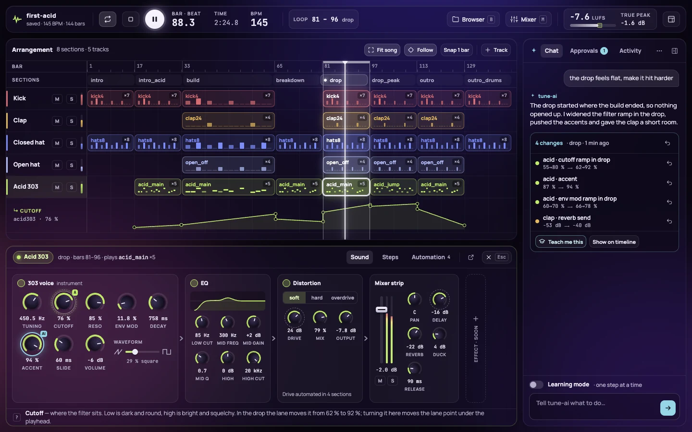
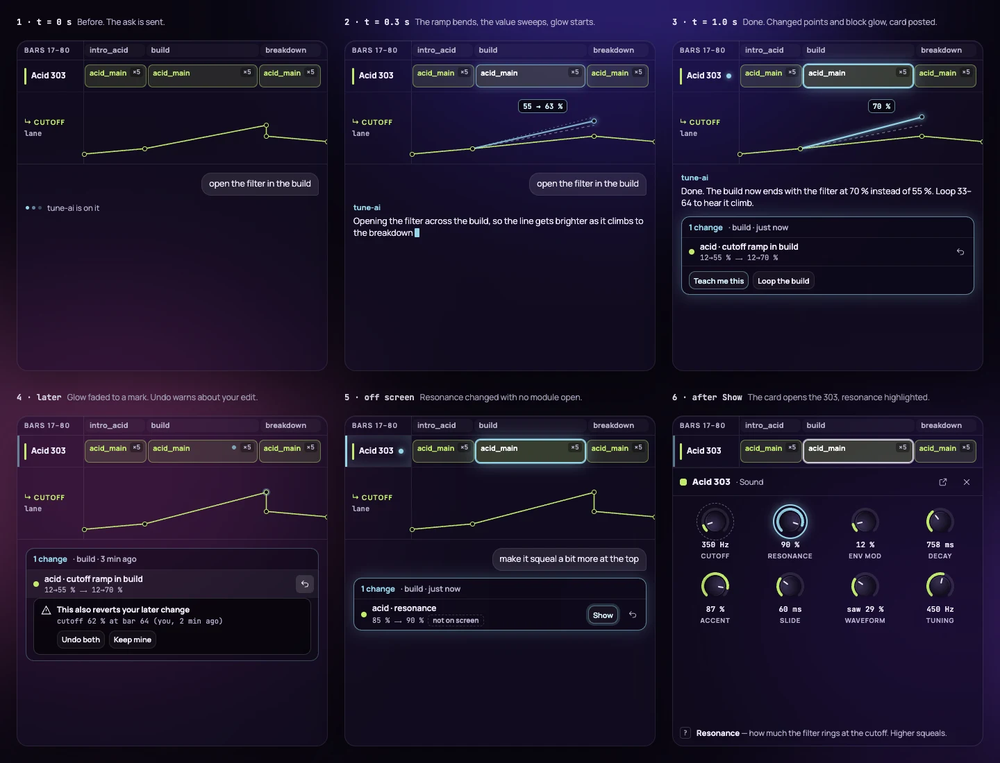
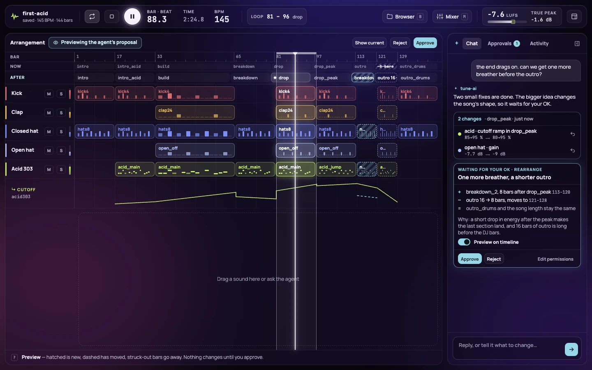
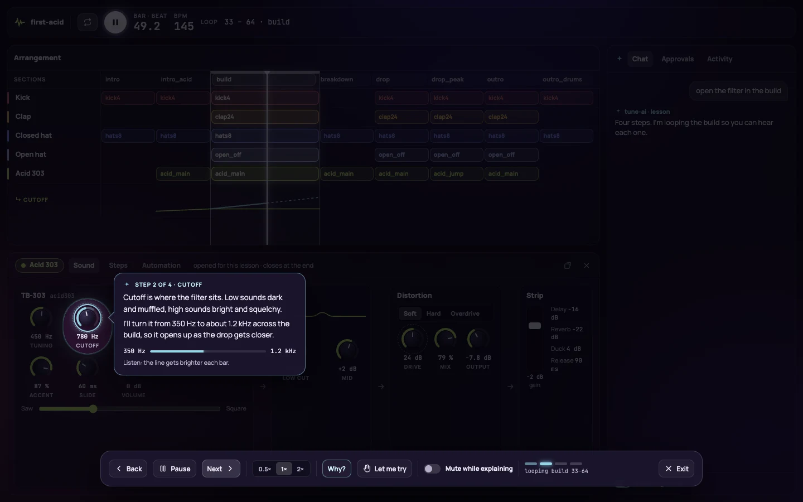
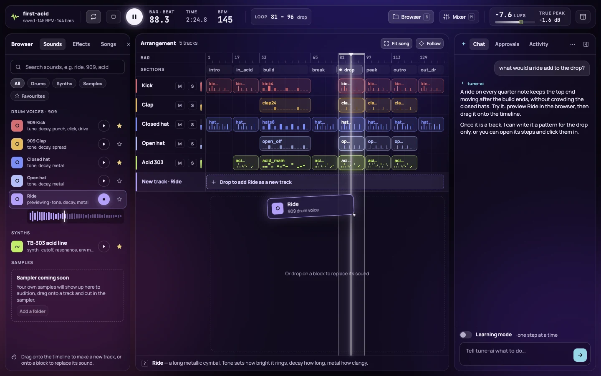
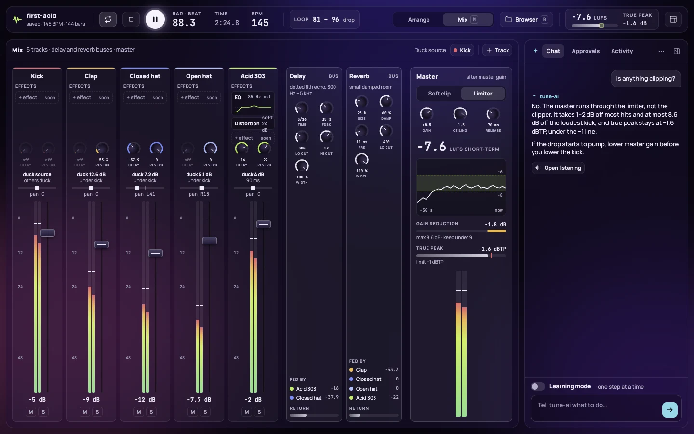
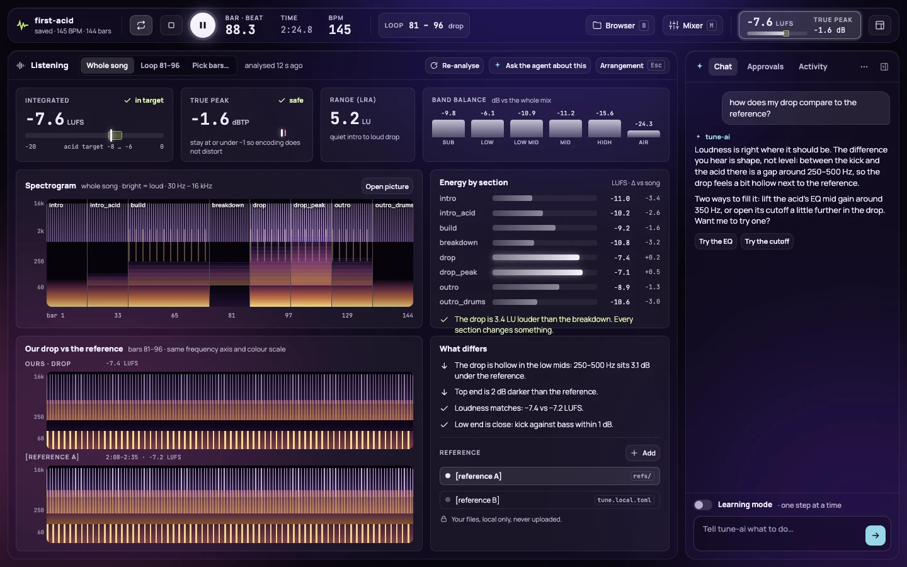

# TuneAI

**A free, open source music workstation that a human and an AI agent drive
together, built so you can learn music production by watching and doing.**

> **Status: paused, open for takers.** The engine, the song format, the agent
> command line and a working prototype studio are real and tested. The
> DAW-class UI and the in-app agent are designed but not built. I'm setting
> this down for now. Fork it, build on it, send pull requests.

## Why this exists

I always wanted to learn music production. Somewhere along the way I started
building the tools instead, because I love building software, and this turned
into one more side project. It got far enough that I think it is worth other
people's time: a faithful Rust port of the TB-303 acid bass, a sample-accurate
engine, songs as plain text files, and a command line an AI agent can drive
without a GUI.

I have to focus on the projects I should actually be finishing, so TuneAI goes
on the shelf for an indefinite time. I might come back to it, because I still
want to learn production. If you want to pick it up before then, please do.
Everything I planned is written down in this repo (see
[where the plans are](#where-to-find-what)), so you don't have to guess where
it was heading.

## The idea

Free, agentic production software that anyone can use to learn production
interactively.

- **Songs are text.** A song is one TOML file: tempo, tracks, clips, sections,
  automation. It diffs in git, a human can read it, and an agent can edit it.
- **Human and agent are equals.** Everything you can do with a knob or a step
  grid, the agent can do through the same action layer. Every agent edit shows
  up on screen (ringed in cyan) and can be undone.
- **The agent can't hear, so it gets ears.** Offline rendering plus loudness,
  frequency balance and spectrogram analysis, and comparison against a
  reference track, let an agent catch objective problems like clipping, mud, or
  a section where nothing changes. Your ears stay the final judge.
- **Learning is the point.** The planned *teach mode* has the agent perform one
  action at a time. It highlights the control it is about to touch and explains
  in a speech bubble what it does and why. You can pause, ask "why?", or take
  over ("let me try") and have it check your result. Vibe with the agent, watch
  it work, learn, then do more by hand.
- **Start with acid techno.** The 303 is the heart of the project. The first
  milestone is a finished ~4-minute acid track.

The full design is in [`docs/superpowers/specs/`](docs/superpowers/specs/) and
the phased plan in [`docs/roadmap.md`](docs/roadmap.md).

### The vision, in mockups

I designed the target studio in Claude Design: a fixed-viewport app shell (an
app, not a website), a browser on the left, arrangement and editors in the
middle, device chains and mixer at the bottom, and a chat dock on the right.
It also covers agent edits, the permission model for "big" changes, and the
teach-mode spotlight and speech bubble flow. None of this UI is built yet;
these are the target.


*The base view. The producer asked for a harder drop; the agent explains what
it changed, lists each change with its own undo, and offers "Teach me this".*

| | |
| --- | --- |
|  |  |
| **The 303 in the dock.** Click a block and its device chain opens below the timeline. | **An agent edit, frame by frame.** The change animates in place, glows, and leaves a card with an undo. |
|  |  |
| **A big change waits for your OK.** The timeline previews it before anything is written. | **Learning mode.** One step at a time, with a spotlight on the control and a "why" for each move. |
|  |  |
| **The browser.** Preview a sound and drag it onto the timeline as a new track. | **The mixer.** Strips, sends, the two buses and the master limiter. |



*The listening view: what the agent "hears". Loudness, band balance, energy
per section and a side-by-side spectrogram against a reference track.*

All 28 boards are in
[`docs/design/studio-canvas/`](docs/design/studio-canvas/), indexed in
`canvas.json`. The images above are exports of eight of them. The board files
themselves need Claude Design's canvas runtime (`support.js`), which is not in
this repo, so they do not render on their own.
[`docs/superpowers/specs/2026-10-21-studio-design-handover.md`](docs/superpowers/specs/2026-10-21-studio-design-handover.md)
and [`docs/superpowers/specs/2026-10-21-studio-ux-brief.md`](docs/superpowers/specs/2026-10-21-studio-ux-brief.md)
describe every screen in words.

## What works today

- **A 303 that matches the original code.** A Rust port of
  [Open303](https://github.com/RobinSchmidt/Open303), checked sample for sample
  against the C++ reference (1e-12 tolerance at module level).
- **Drums and effects:** 909-style kick, clap, hats and ride; distortion, EQ, a
  dotted-eighth delay, a short reverb, kick-triggered ducking, a master
  limiter.
- **One engine, two modes:** offline render to WAV and lock-free live playback
  with hot reload, bitwise identical for the same song.
- **Song format v2:** devices, a clip pool (acid, drum and timed-note clips),
  placements, scenes and slots for session play, automation lanes.
- **The `tune` CLI**, `--json` everywhere: `validate`, `info`, `render`, `play`,
  `set`, `do`, `actions`, `changes`, `analyze`, `compare`, `serve` and more.
- **An action layer** shared by the UI and the CLI, with undo and one-step undo
  of a whole agent run.
- **A prototype studio** (Tauri + React): transport, 303 panel, step
  sequencer, drum grid, arrangement, mixer, and the edit log with Claude's
  edits ringed in cyan.
- **[`songs/first-acid`](songs/first-acid/song.toml):** a full 4-minute acid
  techno track, mixed to about -8.8 LUFS, with the reasoning for each musical
  choice in the comments.
- 800+ Rust tests, JS tests, and a privacy check that keeps audio and personal
  data out of git.

What does not exist yet: the DAW-class UI, the sampler and sample browser, the
in-app agent chat, teach mode, MIDI, third-party plugin hosting. See
[the roadmap](#roadmap-and-where-to-jump-in).

## Quick start

Developed on macOS on Apple Silicon. Other platforms are untested; the audio
backend (`cpal`) is cross-platform, but the demo tasks use macOS `afplay`.

Prerequisites: Rust (stable, edition 2024), [go-task](https://taskfile.dev),
Node.js and pnpm 9.

```sh
git clone https://github.com/biokraft/tune-ai.git && cd tune-ai
task setup    # install the pre-commit privacy hook (once per clone)
task verify   # format, lint, typecheck, tests, privacy check
task demo     # render and play a demo 303 line
task first-acid                                # render and play the full track
task studio SONG=songs/first-acid/song.toml    # the desktop studio
task serve  SONG=songs/first-acid/song.toml    # or in a browser on :4580
```

The full guide to the CLI, the studio, mixing and analysis is
[`docs/usage.md`](docs/usage.md).

## Where to find what

| Path | What is there |
| --- | --- |
| [`crates/tune-dsp`](crates/tune-dsp) | DSP library: the 303 port, drums, effects. No UI or I/O. |
| [`crates/tune-modules`](crates/tune-modules) | Instrument and effect traits and the module registry. |
| [`crates/tune-song`](crates/tune-song) | Song file model: parse, validate, canonical write, migration, edits. |
| [`crates/tune-engine`](crates/tune-engine) | Compiles a song, renders offline or plays live, session launches. |
| [`crates/tune-studio`](crates/tune-studio) | Studio core: actions, undo, edit log, external-change merge. |
| [`crates/tune-analysis`](crates/tune-analysis) | The agent's ears: loudness, spectrum, spectrogram, comparison. |
| [`crates/tune-audio`](crates/tune-audio) | Audio output (`cpal`) and a null output for tests. |
| [`crates/tune-cli`](crates/tune-cli) | The `tune` binary. |
| [`crates/open303-ref`](crates/open303-ref) | Test-only C++ reference build for parity tests. |
| [`apps/desktop`](apps/desktop) | The studio app: React + Vite frontend, Tauri host. |
| [`packages/ui`](packages/ui) | `@tune/ui`: knobs, sequencers, arrangement, mixer, theme tokens. |
| [`songs/`](songs) | Committed songs. |
| [`third_party/open303`](third_party/open303) | Vendored Open303 sources, unmodified. |
| [`docs/roadmap.md`](docs/roadmap.md) | The phased plan and open decisions. |
| [`docs/superpowers/specs/`](docs/superpowers/specs) | Design specs, including the approved Phase 2 model. |
| [`docs/superpowers/plans/`](docs/superpowers/plans) | Plans 1 to 10: how everything built so far was done, step by step. |
| [`docs/design/`](docs/design) | Claude Design mockups of the target studio. |
| [`docs/images/`](docs/images) | README images: exports of the key mockup boards. |
| [`docs/research/`](docs/research) | Genre notes and a survey of music-as-code tools. |
| [`docs/brand/`](docs/brand) | Logo, colours, wordmark. |
| [`AGENTS.md`](AGENTS.md) | Everything a coding agent needs: layout, notation, workflow, rules. |

## Roadmap and where to jump in

Full detail in [`docs/roadmap.md`](docs/roadmap.md). In short:

1. **Product and UX design.** Mockups exist, and eight key boards are
   exported above; they need a final review.
2. **Modular model and engine foundations.** Done (plans 7 to 10).
3. **Samples and the browser.** Sampler instrument, sample library, file
   browser with preview, drag and drop. *Not started.*
4. **The new UI.** Implement the design on top of the real engine: app shell,
   arrangement, piano roll, device rack, mixer, session grid. *Not started.*
5. **The in-app agent.** Chat dock, harness (OpenCode or the Claude Agent SDK,
   settled by a short spike), skills, memories, visible agent actions, teach
   mode. *Not started.*
6. **Learning test:** build a real acid techno track in the new UI.
7. **Expand:** mastering chain, more synths, MIDI mapping, hardtekk tooling.

Good places to start:

- **Phase 3 (samples).** Well-scoped and independent of the UI. Start with the
  sampler instrument as a `tune-modules` module.
- **Phase 4 (UI).** The biggest chunk and the most visible. The action layer it
  needs already exists.
- **The open decisions** at the end of the roadmap, such as which agent harness
  to use. A short spike and a written recommendation is a real contribution.
- **Cross-platform support.** Linux and Windows builds, replacing `afplay` in
  the tasks.
- **More songs, more synths,** and a better ear for what makes the mix work.

## Pick it up with a coding agent

This repo is set up to be continued by an agent such as Claude Code, Codex or
OpenCode. The work so far was built that way.

1. Point the agent at [`AGENTS.md`](AGENTS.md). It holds the layout, the song
   notation, how an agent works with `tune`, the loop for editing and
   listening to a song, and the rules.
2. Have it read [`docs/roadmap.md`](docs/roadmap.md) and the spec for the phase
   you want.
3. Work the way the earlier phases were done: write a spec, then a plan under
   `docs/superpowers/plans/`, then execute the plan task by task. Plans 1 to 10
   show the format. They were written for the
   [superpowers](https://github.com/obra/superpowers) skills, but any
   plan-then-execute loop works.
4. Run `task verify` before every commit. It is the same gate a contributor
   has to pass.

Some rules to hand your agent up front, all in `AGENTS.md`: never commit audio,
keep the Rust port bit-faithful to Open303 (never loosen a parity tolerance),
keep output deterministic, and never copy GPL code (for example JC303).

## Contributing and forking

Forks are welcome, and so are contributions to this repo. Read
[`CONTRIBUTING.md`](CONTRIBUTING.md) first. In short: open an issue before a
large change, keep commits small and conventional, and run `task verify`.
I may be slow to respond, so please don't take it personally. If you would
rather take the project in your own direction, fork it; the license lets you.

## Credits

- [Open303](https://github.com/RobinSchmidt/Open303) by Robin Schmidt (MIT) is
  the reference the 303 is ported from, including Takuya Ooura's FFT package.
- Typefaces: Manrope and JetBrains Mono (SIL OFL 1.1).
- Details and license texts in [`THIRD_PARTY.md`](THIRD_PARTY.md).

## License

[MIT](LICENSE).
